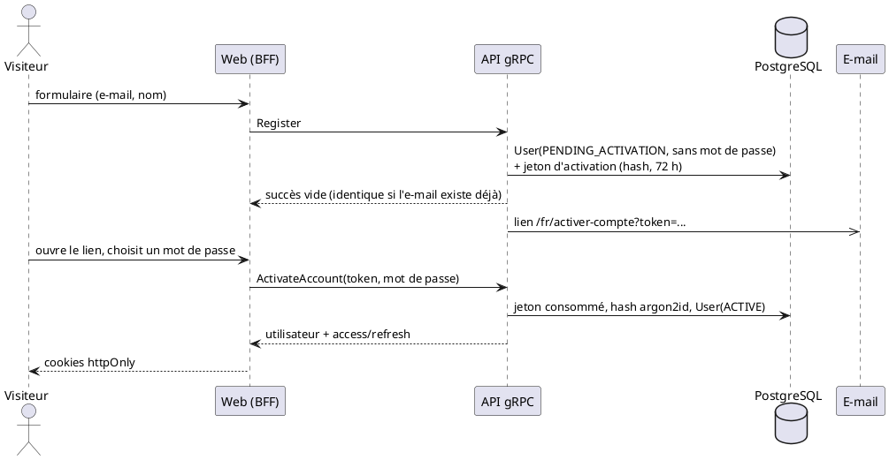
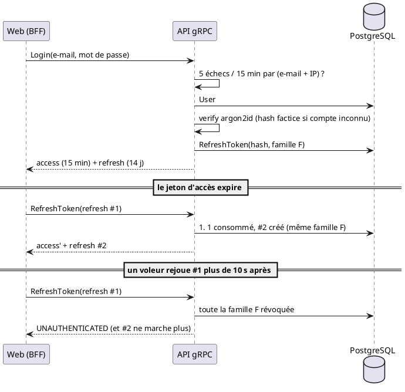

# Authentification et autorisation (Phase 5)

## Principes

| Sujet | Choix | Pourquoi |
|---|---|---|
| Mot de passe | **argon2id** (m = 19 MiB, t = 2, p = 1), sel aléatoire intégré au hash | Recommandation OWASP ; jamais de mot de passe en clair en base ni dans les logs |
| Politique de mot de passe | 10 à 128 caractères, **sans règle de complexité** | Recommandation NIST : la longueur compte, les phrases de passe sont acceptées |
| Jeton d'accès | **JWT HS256**, 15 min, validé avec algorithme, émetteur et audience imposés | Court : limite l'impact d'un vol ; l'en-tête `alg` du jeton n'est jamais utilisé pour choisir l'algorithme |
| Jeton de rafraîchissement | **Opaque** (256 bits aléatoires), 14 jours, **à usage unique** (rotation) | Seul son hash SHA-256 est stocké : une fuite de la base ne donne aucun jeton utilisable |
| Rôle et statut | **Relus en base à chaque appel**, jamais lus dans le jeton | Un compte suspendu ou rétrogradé perd l'accès immédiatement (coût : 1 requête indexée par appel connecté) |
| Stockage côté navigateur | Cookies `httpOnly` + `Secure` + `SameSite=Lax`, posés par le serveur Next.js (Phase 6) | Les jetons ne sont jamais lisibles par le JavaScript de la page |
| Secrets | `JWT_ACCESS_SECRET` dans l'environnement, **l'API refuse de démarrer sans lui** | Rien dans le dépôt |

`JWT_REFRESH_SECRET`, prévu en Phase 1, n'existe pas : le refresh token étant opaque, il n'a pas besoin de secret de signature.

## Ouverture d'un compte (étudiant)

Aucun mot de passe n'est stocké avant la vérification de l'e-mail.



Un compte créé par l'administrateur à l'acceptation d'une inscription (Phase 9) suit exactement le même chemin d'activation.

## Connexion et session



### Détection de rejeu et fenêtre de tolérance

- Un refresh token consommé puis représenté **après plus de 10 secondes** fait révoquer toute la session (vol présumé).
- Dans les 10 secondes, la requête est seulement refusée, **sans couper la session** : plusieurs composants serveur d'une même page peuvent découvrir en même temps que le jeton d'accès a expiré.
- Sous concurrence, **un seul** échange réussit (réclamation atomique en base) : vérifié avec 8 appels simultanés.
- **À faire côté Phase 6** : le serveur Next.js doit regrouper les rafraîchissements d'une même session (un seul appel en vol), pour ne pas multiplier les refus.

## Anti-énumération de comptes

| Action | Comportement |
|---|---|
| `Login` | Même erreur `invalid_credentials` pour : e-mail inconnu, mauvais mot de passe, compte en attente, compte suspendu. Un hash factice est vérifié pour que le temps de réponse ne révèle pas si le compte existe |
| `Register`, `ForgotPassword` | Toujours un succès vide, que l'adresse existe ou non. Le mail part en arrière-plan |
| `Logout` | Toujours un succès (jeton inconnu, expiré ou déjà révoqué) |

Limite connue : l'envoi en arrière-plan rend la différence de durée très faible, mais pas strictement nulle (une écriture en base de plus quand le compte existe).

## Protection contre le brute force

| Protection | Valeur |
|---|---|
| Échecs de connexion | 5 / 15 min par **(e-mail + IP)** ; un succès remet à zéro. Un attaquant distant ne peut pas verrouiller le compte d'une autre personne depuis une autre adresse |
| Échecs de changement de mot de passe | 5 / 15 min par utilisateur |
| Méthodes d'authentification | 30 appels / 5 min par IP (une salle entière peut se connecter depuis la même adresse) |
| E-mails d'activation / réinitialisation | 3 / heure par adresse (anti-inondation) |

Compteurs **en mémoire** : suffisant pour une seule instance d'API. Passer à Redis si l'API est dupliquée (un redémarrage remet les compteurs à zéro).

## Réinitialisation et changement de mot de passe

- Lien à usage unique, **1 h** (réinitialisation) ou **72 h** (activation), seul le hash est stocké ; un nouveau lien invalide les précédents.
- Un lien d'activation ne sert pas à réinitialiser un mot de passe, et inversement.
- Une réinitialisation ou un changement de mot de passe **ferme toutes les sessions** de l'utilisateur.
- Un mauvais mot de passe actuel renvoie `INVALID_ARGUMENT` (et non `UNAUTHENTICATED`) : la session reste valide.

## E-mails

L'API ne connaît pas le fournisseur d'e-mails (interface `EmailProvider`).

| `EMAIL_PROVIDER` | Effet |
|---|---|
| `console` | Affiche le lien dans les logs. **Développement uniquement** : refusé au démarrage en production, car un lien dans les logs donne accès au compte |
| `none` | N'envoie rien (défaut en production) |
| SMTP | Phase 12 |

**Conséquence importante** : tant que le SMTP n'est pas branché, en production, ni l'activation de compte ni « mot de passe oublié » ne peuvent fonctionner. Le premier administrateur se crée avec `pnpm admin:create` (sans e-mail).

## Premier administrateur

```
pnpm admin:create
```

Demande l'e-mail, le prénom, le nom, puis le mot de passe (saisie masquée, jamais écrit sur disque ni dans l'historique du terminal). Refuse d'écraser un compte existant. Il n'existe **aucun compte par défaut** dans le dépôt.

## Contrôle d'accès

La table `apps/api/src/grpc/policies.ts` donne, pour **chaque** méthode du contrat, qui peut l'appeler (public, connecté, ou liste de rôles). Une méthode sans politique empêche la compilation.

Les méthodes pas encore implémentées sont enregistrées avec un handler qui répond `UNIMPLEMENTED` **après** les contrôles d'accès : un visiteur anonyme reçoit `UNAUTHENTICATED` sur une méthode d'administration, un étudiant `PERMISSION_DENIED`, seul un administrateur voit `UNIMPLEMENTED`.

Sur une méthode **publique**, un jeton expiré ou invalide est traité comme « anonyme » : une page publique ne casse pas quand le jeton d'un visiteur connecté expire.

## Limites et décisions à revalider

| Sujet | État |
|---|---|
| Vérification de l'e-mail à l'ouverture de compte | Faite par le lien d'activation (dépend du SMTP en production) |
| HS256 (secret partagé) | Adapté à un monolithe. Si des services séparés doivent vérifier les jetons sans connaître le secret : passer à une clé asymétrique (EdDSA) |
| Authentification à deux facteurs | Non prévue |
| Journal des connexions | Seule la dernière connexion est enregistrée (`lastLoginAt`) ; les échecs sont dans les logs applicatifs |
| Mineurs | Règle de consentement parental toujours à définir (juridique) |
